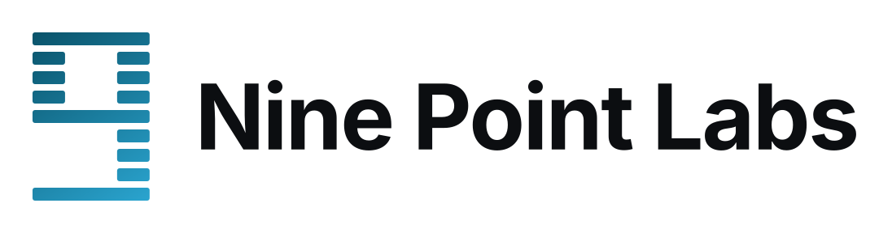

<picture>
  <source media="(prefers-color-scheme: dark)" srcset="assets/npl-lockup-horizontal-light-on-dark.svg" />
  <source media="(prefers-color-scheme: light)" srcset="assets/npl-lockup-horizontal-dark-on-light.svg" />
  
</picture>

# Nine Point Labs

---

### ✦ Hi, I'm Tim

Combat veteran, semi-retired technologist, Tae Kwon Do dad in East Texas. I write some of the code and direct a small crew of AI agents for the rest. They're named after Ted Lasso characters. No, I will not be taking questions.

Most of what I build is native to [Omarchy](https://omarchy.org), and all of it is open source except Persistwise. I write about it all on [the blog](https://blog.ninepointlabs.com).

**Why nine?** In the Army, a nine-line is a short report with nine items. You fill it in, send it, and help is on the way. No fluff, nothing extra, and it works when it counts. I carried that idea with me from the infantry into building software. Nine Point Labs makes small, clear tools for Linux and the open web that do their job and stay out of your way. (And yes, the 'Labs' is a little nod to Bell Labs.)

### ✦ Fresh off the press

Latest releases, newest first. The [blog](https://blog.ninepointlabs.com) has the stories.

- 📖 **[Dogear 0.1.0](https://github.com/ninepointlabs/dogear/releases/tag/v0.1.0)**: a PDF reader for studying
- 🌴 **[Hyprfall 0.1.2](https://github.com/ninepointlabs/hyprfall/releases/tag/v0.1.2)**: a jungle platformer native to Omarchy
- 🧺 **[Barback 0.1.1](https://github.com/ninepointlabs/barback/releases/tag/v0.1.1)**: one bar chip, several plugins
- 🔐 **[Omostrich 0.2.1](https://github.com/ninepointlabs/omostrich/releases/tag/v0.2.1)**: local Nostr key custody
- 🐦 **[Kestrel 0.1.1](https://github.com/ninepointlabs/kestrel/releases/tag/v0.1.1)**: post to X from the terminal
- 🔗 **[Linkguard 0.1.0](https://github.com/ninepointlabs/linkguard/releases/tag/v0.1.0)** and 📁 **[folderblog 0.2.2](https://github.com/ninepointlabs/folderblog/releases/tag/v0.2.2)**: for people who write
- ⏱️ **[wow-reset 0.2.1](https://github.com/ninepointlabs/omarchy-wow-reset/releases/tag/v0.2.1)** and 🕊️ **[Bahá'í Reader 0.1.3](https://github.com/ninepointlabs/bahai-reader/releases/tag/v0.1.3)**

### ✦ The Workshop

The projects featured on [ninepointlabs.com](https://ninepointlabs.com).

**On the desktop**

<table>
<tr><td width="50%" valign="top">

🍳 **[Repokase](https://repokase.ninepointlabs.com)** 
Your repos, chef's choice. Every GitHub repository you own or share, in one keyboard-driven app.
 `Python` · `Omarchy`

</td><td width="50%" valign="top">

🗃️ **[Jubako](https://jubako.ninepointlabs.com)** 
A simple database for your own computer. Like the old Microsoft Access, without the hard parts.
 `Python` · `Omarchy`

</td></tr>
<tr><td width="50%" valign="top">

✍️ **[Rune](https://rune.ninepointlabs.com)** *(beta)* 
A word processor that writes *with* you. ODF-first, with real `.docx` round-trips.
 `C++` · `Omarchy`

</td><td width="50%" valign="top">

📖 **[Dogear](https://dogear.ninepointlabs.com)** 
Read, highlight and remember your PDFs. A PDF reader for studying.
 `Python` · `Omarchy`

</td></tr>
<tr><td width="50%" valign="top">

⚔️ **[omaforge](https://omaforge.ninepointlabs.com)** 
World of Warcraft addons, on Linux. CurseForge, WoWInterface and GitHub.
 `Python` · `Omarchy`

</td><td width="50%" valign="top">

🕊️ **[Bahá'í Reader](https://bahaireader.org)** 
A quiet place for the Writings. Offline prayer book and reader for Linux.
 `Python` · `GTK 4`

</td></tr>
<tr><td width="50%" valign="top">

🌴 **[Hyprfall](https://hyprfall.ninepointlabs.com)** 
Don't fall in the node_modules. A jungle platformer that wears your Omarchy theme.
 `JavaScript` · `Game`

</td><td width="50%" valign="top">

🔐 **[Omostrich](https://github.com/ninepointlabs/omostrich)** 
Local Nostr key-custody daemon. Your `nsec` stays home; signing happens over a socket and NIP-46.
 `Nostr` · `Omarchy`

</td></tr>
</table>

**In the terminal and the bar**

<table>
<tr><td width="50%" valign="top">

🕵️ **[Speakeasy](https://github.com/ninepointlabs/speakeasy)** 
The back room for your AI agents. Claude Code, Codex and friends in hidden terminals, one named task each.
 `Python` · `Omarchy bar`

</td><td width="50%" valign="top">

🔄 **[omasync](https://github.com/ninepointlabs/omasync)** 
Syncthing in the Omarchy bar: folders, devices and transfer rates at a glance.
 `QML` · `Omarchy bar`

</td></tr>
<tr><td width="50%" valign="top">

📬 **[fm-cli](https://github.com/ninepointlabs/fm-cli)** 
Fastmail from the terminal, spoken fluently in JMAP. Full-screen TUI plus scriptable JSON commands.
 `Go` · `TUI`

</td><td width="50%" valign="top">

📦 **[autonomix-cli](https://github.com/ninepointlabs/autonomix-cli)** 
Install apps straight from GitHub Releases. Obtainium for the command line.
 `Go` · `CLI`

</td></tr>
<tr><td width="50%" valign="top">

🐦 **[Kestrel](https://github.com/ninepointlabs/kestrel)** 
Post to X from the terminal, or let your agents do it over MCP, with a hard daily limit.
 `Rust` · `MCP`

</td><td width="50%" valign="top">

💡 **[ideas](https://github.com/ninepointlabs/ideas)** 
Jot it down before it's gone. A numbered list of ideas in a plain Markdown file.
 `Go` · `CLI`

</td></tr>
<tr><td width="50%" valign="top">

🧺 **[Barback](https://github.com/ninepointlabs/barback)** 
A drawer for the Omarchy bar: one chip holds several plugins, so the ones you're trialling take a single slot.
 `QML` · `Omarchy bar`

</td><td width="50%" valign="top">

🍺 **[barkeep](https://github.com/ninepointlabs/barkeep)** 
Tends your Omarchy bar. Arrange, pin, update and remove plugins from one overlay.
 `QML` · `Omarchy bar`

</td></tr>
</table>

**For people who write**

<table>
<tr><td width="50%" valign="top">

📁 **[folderblog](https://folderblog.ninepointlabs.com)** 
A folder is a blog. Save Markdown into a folder and it's live seconds later. This blog runs on it.
 `Rust` · `GitHub Pages`

</td><td width="50%" valign="top">

🗄️ **[Persistwise](https://persistwise.com)** 
Writing that outlasts the platform. Every new post archived to the Wayback Machine, IPFS and your own disk.
 `Rails 8` · web service

</td></tr>
<tr><td width="50%" valign="top">

🔗 **[Linkguard](https://linkguard.persistwise.com)** 
Dead links, found and fixed. Swaps in a Wayback Machine snapshot for Jekyll, Hugo and folderblog sites.
 `TypeScript` · `GitHub Action`

</td><td width="50%" valign="top">

📜 **[StoryTracker](https://github.com/ninepointlabs/wow-storytracker-addon)** 
A WoW addon that logs your adventures so each session can become a story post.
 `Lua` · `WoW Forever` & `Retail`

</td></tr>
</table>

<b>🧩 More Omarchy bar plugins</b>: the bar is crowded and I regret nothing

 

[omarchy-spotify](https://github.com/ninepointlabs/omarchy-spotify) ·
[omarchy-fastmail](https://github.com/ninepointlabs/omarchy-fastmail) ·
[omarchy-fastmail-calendar](https://github.com/ninepointlabs/omarchy-fastmail-calendar) ·
[omarchy-hey-calendar](https://github.com/ninepointlabs/omarchy-hey-calendar) ·
[omarchy-hermes-chat](https://github.com/ninepointlabs/omarchy-hermes-chat) ·
[omarchy-ring-cameras](https://github.com/ninepointlabs/omarchy-ring-cameras) ·
[omarchy-upcoming](https://github.com/ninepointlabs/omarchy-upcoming) ·
[omarchy-webcam](https://github.com/ninepointlabs/omarchy-webcam) ·
[omarchy-autonomix](https://github.com/ninepointlabs/omarchy-autonomix) ·
[omarchy-wow-reset](https://github.com/ninepointlabs/omarchy-wow-reset) ·
[omarchy-theme-rotate](https://github.com/ninepointlabs/omarchy-theme-rotate)

**Just for fun:** [Zork I–III](https://github.com/ninepointlabs/omarchy-zorkmachy) ·
[dopewars](https://github.com/ninepointlabs/omarchy-dopewars)

More on the [Nine Point Labs for Omarchy](https://omarchy.ninepointlabs.com) hub.

<b>🎨 Omarchy themes</b>: because the desktop should look like you

 

[US Army](https://github.com/ninepointlabs/omarchy-us-army-theme) ·
[Ted Lasso](https://github.com/ninepointlabs/omarchy-ted-lasso-theme) (Believe.) ·
[Bahá'í](https://github.com/ninepointlabs/omarchy-bahai-theme) ·
[Warcraft: Alliance](https://github.com/ninepointlabs/omarchy-warcraft-alliance-theme) ·
[Warcraft: Horde](https://github.com/ninepointlabs/omarchy-warcraft-horde-theme) ·
[WoW Forever: Campfire](https://github.com/ninepointlabs/omarchy-wow-forever-campfire-theme) ·
[nene-royal](https://github.com/ninepointlabs/omarchy-nene-royal) (got out of hand)

<b>⌨️ Nostr and terminal odds and ends</b>

 

[omostrich-db](https://github.com/ninepointlabs/omostrich-db) read-only Nostr analytics for your own notes, with MCP tools for agents ·
[omostrich.com](https://omostrich.com) Omostrich explained in plain language ·
[tfz](https://github.com/ninepointlabs/tfz) RSS that renders the *full* article

### ✦ On the Bench

- 📖 **Dogear** just reached 0.1.0, and **Barback** and **Hyprfall** are new this month. Still finding out what they're missing.
- 🔐 **[Omostrich](https://github.com/ninepointlabs/omostrich)** is at 0.2 with its read-only sibling, [omostrich-db](https://github.com/ninepointlabs/omostrich-db).
- 🤖 Handing the agents more of the busywork, like blog posts and release notes, while I do the worrying.
- 💡 Whatever idea won't leave me alone this week.

 

  

Linux user who will absolutely judge your OS choice, then offer to help you switch distros anyway.

